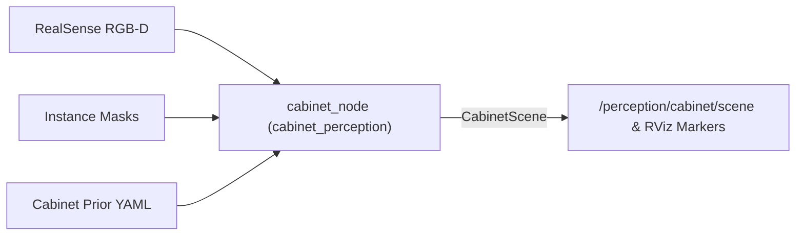

# perc-cabinet_perception

[](https://docs.ros.org/en/humble/) [](LICENSE) [](mailto:teamrobontu@gmail.com)

RGB-D cabinet and shelf perception for mobile manipulation on ROS 2 Humble. From depth point clouds and instance masks, it detects shelf boards, splits each level into cubbies, assigns detected objects to cubbies, measures free space, and publishes a `CabinetScene` (`object_grouping_interfaces/CabinetScene`).

ROS 2 Humble, Python 3.10, numpy + scipy (no ML in the perception itself).


## Architecture



## Repository layout

```text
perc-cabinet_perception/
├── cabinet_perception/         # ROS 2 perception package
└── object_grouping_interfaces/ # ROS 2 message/service interfaces (CabinetScene, DetectedObject, ObjectGroup, Shelf)
```

## Setup

Install Python dependencies:
```bash
pip install -r requirements.txt
```

Underlay: [`public-core-grasp`](https://github.com/Team-Robo/public-core-grasp) (for `core_r1_interfaces`).

```bash
# camera + Foxglove
sudo apt install ros-humble-realsense2-camera ros-humble-foxglove-bridge python3-scipy python3-opencv
# RealSense udev rules (once): config/99-realsense-libusb.rules from github.com/IntelRealSense/librealsense
sudo cp 99-realsense-libusb.rules /etc/udev/rules.d/ && sudo udevadm control --reload-rules && sudo udevadm trigger

mkdir -p ~/ros2_ws/src && cd ~/ros2_ws/src
git clone https://github.com/Team-Robo/public-perc-cabinet_perception.git perc-cabinet_perception

cd ~/ros2_ws
source /opt/ros/humble/setup.bash && source ~/core-grasp/install/setup.bash
colcon build --symlink-install --packages-select object_grouping_interfaces cabinet_perception
source install/setup.bash
colcon test --packages-select cabinet_perception && colcon test-result --verbose
```

## Run

**1. Live camera** (using an external RGB-D camera and instance segmenter):

```bash
ros2 launch cabinet_perception cabinet_perception.launch.py \
    prior_file:=$(ros2 pkg prefix cabinet_perception)/share/cabinet_perception/config/bench_cabinet.yaml \
    live_period:=1.0
```

**2. No camera** (synthetic 4 x 2 or 3 x 3 cabinet with ground-truth masks):

```bash
ros2 launch cabinet_perception cabinet_perception.launch.py synthetic:=true live_period:=1.0
ros2 launch cabinet_perception cabinet_perception.launch.py synthetic:=true synthetic_scene:=grid live_period:=1.0
```

**3. Handheld camera** (estimate `map -> cabinet` TF from the point cloud):

```bash
ros2 launch cabinet_perception cabinet_perception.launch.py localize:=true relocalize:=true live_period:=1.0
```

Visualise in Foxglove (`ws://localhost:8765`) or RViz:

| Panel | Topic / setting |
|---|---|
| Image | `/cabinet_perception/overlay` - boards, splits (magenta), free space boxes, objects (red) |
| 3D | display frame `cabinet`; `/cabinet_perception/cloud`, `/cabinet_perception/markers` |
| 3D, hide frame names | panel settings → *Transforms* → *Labels* off |

Overlay colours: **green** free space = next to a group, **blue** = empty part of the shelf. Thick base = board top seen, thin = inferred.

## Configuring the cabinet prior

Measure the cabinet once and write a YAML like [config/bench_cabinet.yaml](cabinet_perception/config/bench_cabinet.yaml): `width`, `depth`, `height`, `boards_z` (top surface of each board, from the cabinet bottom) and `dividers_x`. With it, the cabinet sides snap to the side walls and the levels/splits are known, so angled or close views stay correct. Without `prior_file` everything is estimated from the cloud, which needs the board tops in view and fails next to other furniture.

## Interfaces

| | Name | Type |
|---|---|---|
| sub | `/camera/camera/color/image_raw`, `.../aligned_depth_to_color/image_raw`, `.../color/camera_info` | `sensor_msgs` |
| sub | `/perc/grasp/instances` | `core_r1_interfaces/InstanceSegmentation` |
| pub | `/perception/cabinet/scene` (latched) | `object_grouping_interfaces/CabinetScene` |
| pub | `/cabinet_perception/overlay`, `/cloud`, `/markers` | image, point cloud, markers (cabinet frame) |
| srv | `/cabinet_perception/scan`, `/cabinet_perception/reset` | `std_srvs/Trigger` |
| TF | `map → cabinet` | broadcast by the node (`localize`) or from the prior |

Cubby ids are `s<level>_<left|right>`, levels counted from 1 at the bottom. Cabinet frame: x right (facing it), y into it, z up, origin at the bottom-front-left corner.

## Launch arguments (`cabinet_perception.launch.py`)

| Argument | Default | |
|---|---|---|
| `prior_file` | `""` | setup-day cabinet YAML (empty = `config/cabinet_prior.yaml`) |
| `synthetic` | `false` | publish a synthetic cabinet instead of a real camera |
| `synthetic_scene` | `demo` | `demo` (4 x 2) \| `grid` (3 x 3) |
| `localize` | `false` | estimate `fixed_frame -> cabinet` from the cloud |
| `relocalize` | `false` | with `localize`: re-estimate on every scan |
| `live_period` | `0.0` | rebuild every N s; `0.0` = only on `~/scan` |

## Known limits

- Free space is per shelf in `CabinetScene` (widest segment); per-cubby free space waits for the v0.2 interface.
- Levels above the camera: low objects at the back can hide behind the board edge (those free boxes are "inferred").
- One camera source at a time: two launches mix frames.

## References

- [realsense-ros](https://github.com/IntelRealSense/realsense-ros) — Intel RealSense ROS 2 RGB-D driver
- [SciPy](https://github.com/scipy/scipy) & [OpenCV](https://github.com/opencv/opencv) — geometric plane fitting and depth/mask processing

## Contributors

- **Chen Ting-Ju (Cynthia)** (`@cynthia-ccluna`)

Maintained by **Nanyang Technological University Team Robo** (`teamrobontu@gmail.com`).
## License

This project is licensed under the Apache-2.0 License — see the [LICENSE](LICENSE) file for details.
